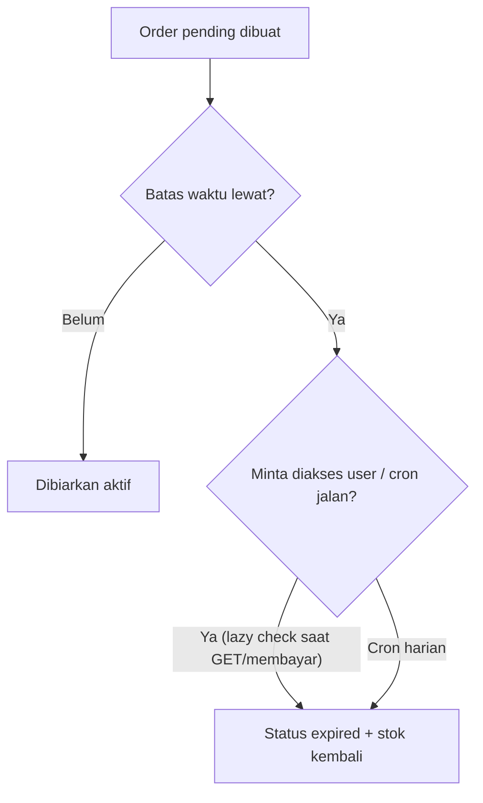

# Architecture — Gambaran Setiap Sistem

> Dokumen ini menjelaskan **cara kerja arsitektur aplikasi** secara sederhana: aliran request,
> struktur folder, pola 3 lapis, cara autentikasi, dua client Supabase, strategi expired order,
> dan rencana deploy ke Vercel.

---

## 1. Gambaran Besar

Satu project Next.js berisi **frontend (React)** dan **backend (Route Handlers)** sekaligus.
Server (Next.js) berbicara ke **Supabase** (Postgres + Auth + RLS). Deploy di **Vercel**.

```mermaid
flowchart LR
    subgraph Browser
        UI[React / frontend]
    end

    subgraph Vercel [Next.js di Vercel]
        RH[Route Handlers (app/api/*)]
        SVC[Service / logika bisnis lib/services]
    end

    subgraph Supabase [Supabase Cloud]
        PG[(Postgres + RLS)]
        AUTH[Supabase Auth]
    end

    UI -->|request HTTP + cookie sesi| RH
    RH --> SVC
    SVC -->|query + RLS| PG
    SVC -->|verifikasi token / session| AUTH

    CRON[Vercel Cron] --> RH --> SVC
    GW[Payment Gateway<br/>(MVP: simulasi, lanjutan: Midtrans/Xendit)] -->|webhook POST| RH
```

Arti baca gambar ini:

1. **Browser** berbicara hanya ke Next.js (Route Handler). Browser **tidak pernah** langsung ke
   Supabase untuk data sensitif — Supabase hanya diakses lewat server kita (kecuali sesi dibaca
   lewat cookie dari Supabase Auth).
2. **Route Handler** menerima request, cek izin, panggil service.
3. **Service** berisi logika bisnis (buat order, konfirmasi bayar, check-in) dan memakai
   Supabase (client server/service role, RPC atomik).
4. **Vercel Cron** menjalankan pekerjaan rutin (mis. menandai order expired).
5. **Payment Gateway** mengirim notifikasi lewat **webhook** yang divalidasi.

---

## 2. Struktur Folder (Sederhana)

```text
ticket-event/
├─ app/
│  ├─ layout.tsx                  # Layout utama seluruh halaman
│  ├─ page.tsx                    # Beranda (event terbaru & populer)
│  ├─ (public)/                   # Halaman publik
│  │  ├─ events/                  #   daftar event + pencarian & filter
│  │  └─ events/[eventSlug]/      #   detail event
│  ├─ (auth)/                     # Registrasi & login
│  ├─ account/                    # Profil, riwayat pesanan, e-ticket (wajib login)
│  ├─ admin/                      # Dashboard admin (statistik, CRUD, laporan, audit log)
│  └─ api/                        # Route Handlers (backend) — pola di bagian 3
│     ├─ auth/                    #   register, login, logout
│     ├─ profile/                 #   GET/PATCH profil
│     ├─ events/                  #   GET list/detail event publik
│     ├─ categories/              #   GET daftar kategori
│     ├─ orders/                  #   buat, lihat, batal order
│     ├─ payments/                #   simulasi bayar
│     ├─ webhooks/                #   payment webhook
│     ├─ tickets/                 #   lihat e-ticket
│     ├─ check-in/                #   validasi QR (staff/admin)
│     ├─ admin/                   #   admin: events, ticket-types, users, orders, payments, reports, stats, audit-logs
│     └─ cron/                    #   expire-orders (dipanggil Vercel Cron)
├─ components/                    # Komponen React yang dipakai ulang
├─ lib/
│  ├─ supabase/
│  │  ├─ client.ts                # Client BROWSER (anon key)
│  │  ├─ server.ts                # Client SERVER (anon key + cookie sesi)
│  │  └─ admin.ts                 # Client SERVER (service role) — JANGAN dipakai di browser
│  ├─ validators/                 # Skema zod (satu skema per fitur)
│  ├─ services/                   # Logika bisnis (1 fungsi = 1 hal)
│  ├─ permissions.ts              # Helper cek role & kepemilikan
│  ├─ response.ts                 # Pembentuk response standar { success, data, error }
│  ├─ logger.ts                   # Writer audit log + log server
│  └─ errors.ts                   # Daftar kode error (lihat api-contract.md)
├─ .env.example                   # Contoh variabel lingkungan (TANPA nilai rahasia)
└─ vercel.json                    # Konfigurasi cron (jika pakai berkas ini)
```

Penjelasan singkat tiap area:

| Area | Fungsinya |
| --- | --- |
| `app/(public)`, `(auth)`, `account`, `admin` | Halaman React (frontend). User melihat di sini. |
| `app/api/*` | Backend. Semua request data lewat sini. |
| `lib/services` | Isi logika bisnis (jangan tulis logika DI Route Handler, biar mudah diuji). |
| `lib/validators` | Skema zod, satu sumber validasi. |
| `lib/supabase/*` | Tiga pola koneksi Supabase (browser / server / service role). |

---

## 3. Pola 3 Lapis: Route Handler → Service → Supabase

Tiga lapis, aturan satu arah (Route Handler panggil Service, Service panggil Supabase).
Tidak ada lapisan tambahan, tidak ada "tinggi" CSS/solid sengaja — sederhana.

```mermaid
flowchart LR
    REQ[Request dari Browser] --> RH[Route Handler<br/>1. terima request<br/>2. cek login & role<br/>3. validasi zod<br/>4. panggil service]
    RH --> SV[Service<br/>logika bisnis, 1 fungsi = 1 hal]
    SV --> DB[Supabase<br/>client server / service role<br/>query + RPC atomik]
    SV --> AUD[audit_logs / logger]
    DB --> SV --> RH --> RES[Response standar<br/>{ success, data, error }]
```

### Contoh kecil: buat order (`POST /api/orders`)

**Lapisan 1 — Route Handler** (`app/api/orders/route.ts`)
- Baca sesi (apakah login?).
- Validasi body pakai skema zod dari `lib/validators`.
- Cek peran & kepemilikan lewat helper dari `lib/permissions`.
- Panggil fungsi service `buatOrder(...)`.
- Ubah hasil menjadi response standar (gagal → kode error).

**Lapisan 2 — Service** (`lib/services/order-service.ts`)
- Periksa lagi `max_per_order` & apakah event masih bisa dijual.
- Panggil RPC atomik `reserve_tickets` (data-model.md bagian 6) → kalau `OUT_OF_STOCK`, lempar error itu.
- Hitung `totalAmount`, `payment_due_at = now + 15 menit`.
- Tulis `audit_logs`.

**Lapisan 3 — Supabase**
- RPC `reserve_tickets` menjalankan satu transaksi (kurangi stok + buat order). Service role ini
  legal karena dijalankan dari kode server, bukan browser.

> Satu fungsi = satu hal. `buatOrder` hanya membuat order; `konfirmasiPembayaran` hanya
> menandai paid + menerbitkan tiket; `prosesCheckIn` hanya memvalidasi QR. Jangan campur.

---

## 4. Autentikasi (Supabase Auth + Cookie Session)

1. **Registrasi / login** memakai **Supabase Auth** (server-side `createClient` dengan anon key
   + cookie store).
2. Supabase Auth menyimpan **sesi di cookie** (HttpOnly). Dengan begitu React tidak pernah
   melihat token sesi mentah.
3. Di Route Handler, kita memakai `auth.getUser()` (client server) untuk:
   - tahu **siapa** user-nya (`id`),
   - lalu baca **role** dari `profiles.role` (bukan dari klaim sesi — role bisa diubah admin,
     jadi selalu baca dari database tiap request yang butuh cek).
4. **Penurunan hak**: tiap endpoint panggil helper `requireRole(aktifUser, ['admin'])` atau
   `requireOwner(aktifUser, orderUserID)` sebelum memroses.

Urutan cek (sama seperti `docs/permission.md` bagian 5):

1. Login? (401 bila belum)
2. Role berhak? (403)
3. Datanya miliknya? (403)
4. Input zod valid? (400)

---

## 5. Dua Client Supabase: Kapan Memakai Yang Mana

| Client | File | Key | Bisa di browser? | Dipakai untuk |
| --- | --- | --- | --- | --- |
| **Browser** | `lib/supabase/client.ts` | `NEXT_PUBLIC_SUPABASE_ANON_KEY` | YA | Membaca sesi untuk keputusan UI (tombol mana yang tampil), auth event. **Tidak dipakai untuk akses data bisnis.** |
| **Server** | `lib/supabase/server.ts` | `NEXT_PUBLIC_SUPABASE_ANON_KEY` + cookie | TIDAK | Route Handlers & Server Components: baca sesi/`getUser()`, query dengan **RLS aktif**. |
| **Service Role** | `lib/supabase/admin.ts` | `SUPABASE_SERVICE_ROLE_KEY` | **TIDAK BOLEH** | Hanya kode server: tugas dalam satu transaksi (RPC `reserve_tickets`, konfirmasi pembayaran, terbitkan tiket, ubah role), dan selalu lewat kode yang kita tulis. **Membypass RLS — dilarang bocor ke browser.** |

Aturan kunci:

- **`SUPABASE_SERVICE_ROLE_KEY` tidak pernah** muncul di `NEXT_PUBLIC_*`, tidak pernah dikirim
  ke frontend/browser, tidak pernah dipakai di komponen React. Hanya di `lib/supabase/admin.ts`.
- Browser hanya melihat `anon key`. Data sensitif (order, payment, tiket, audit log) **wajib**
  lewat Route Handler yang mengatur izin—bukan lewat client browser langsung.
- RLS tetap hidup untuk client server; service role dipakai hanya untuk pekerjaan yang memang
  sistem (atomik), bukan untuk sembarang query dari Route Handler.

---

## 6. Environment Variables (`.env.example`)

```text
# Supabase Project (dapat dari dashboard Supabase: Settings > API)
NEXT_PUBLIC_SUPABASE_URL=https://xxxx.supabase.co
NEXT_PUBLIC_SUPABASE_ANON_KEY=eyJhbGciOi...

# Khusus SERVER (jangan pernah dibuka ke frontend)
SUPABASE_SERVICE_ROLE_KEY=eyJhbGciOi...

# Rahasia untuk memvalidasi webhook pembayaran
PAYMENT_WEBHOOK_SECRET=ganti-dengan-token-acak-panjang

# Pengaman endpoint cron (Vercel Cron). WAJIB sama dengan yang dicatat di Vercel.
CRON_SECRET=ganti-dengan-token-acak-lain

# Mode pembayaran: simulation (MVP). Lanjutan: midtrans / xendit
PAYMENT_MODE=simulation
```

Aturan (dari `AGENT.md`):

- Tidak ada nilai rahasia asli yang ditulis ke `.env.example` — cukup placeholder.
- File `.env` lokal tidak pernah di-commit. `.env.example` di-commit.
- Semua nilai rahasia dibaca dengan `process.env` di **server** saja.

---

## 7. Strategi Expired Order (cek saat diakses + Vercel Cron)

Order `pending` yang lewat `payment_due_at` harus jadi `expired` dan stok kembalian.
Dua mekanisme (saling melengkapi):

### 7.1 Cek saat order diakses (lazy)
- Setiap kali frontend minta **detail order**, **status pembayaran**, atau mencoba **membayar**,
  Route Handler service harus memeriksa: kalau `status = awaiting_payment` dan
  `payment_due_at < now` → jalankan logika expired **sebelum** melanjutkan response.
- Manfaat: tanpa cron pun, user yang menanyakan order yang telat langsung diberi status `expired`
  dan stok kembaliannya berhasil dieksekusi.

### 7.2 Vercel Cron (rutin)
- Satu endpoint dijadwalkan: `GET /api/cron/expire-orders`, dilindungi `CRON_SECRET`.
- Vercel Cron memanggilnya **setiap hari**.
- Endpoint ini: cari order `awaiting_payment` yang `payment_due_at` sudah lewat → ubah
  `orders.status = expired`, `payments.status = expired`, kembalikan `stock_sold`, tulis audit log.



Keputusan ini **menggantikan** catatan "cron setiap menit" yang sebelumnya ada di
`docs/order-flow.md` bagian 4; dokumen itu sudah diselaraskan.

---

## 8. Rencana Deploy di Vercel

Urutan saat project siap MVP:

1. **Siapkan Supabase:** buat project, jalankan migrasi tabel + RLS + enum + RPC
   (dari `docs/data-model.md`), aktifkan Auth, setelah deployment buat user admin
   (proses pembuatan admin dijelaskan saat fase coding — jangan menebak).
2. **Inisialisasi Git** di project lalu push ke GitHub (mis. repo `ticket-event`).
3. **Import ke Vercel:** Dashboard Vercel → *Add New Project* → pilih repo. Framework terdeteksi
   Next.js otomatis.
4. **Isi Environment Variables** di Vercel (Settings → Environment Variables) persis seperti
   `.env.example`. Jangan pernah menempel `.env` lokal.
5. **Atur cron:** definisikan di `vercel.json` (contoh `"cron": [{ "path": "/api/cron/expire-orders", "schedule": "0 9 * * *" }]`), lalu set nilai `CRON_SECRET` yang sama di Vercel.
6. **Deploy** → pada build, jalan `next build` (equivalent) untuk lint/typecheck; Vercel
   menampilkan log kalau gagal.
7. **Verifikasi manual:** (a) daftar/login, (b) buat event & tiket lewat admin, (c) beli tiket
   simulasi → e-ticket terbit, (d) cek QR di endpoint check-in (tiket kedua kali ditolak),
   (e) biarkan order lewat waktu → status expired & stok kembali.
8. **Domain / kustomisasi** bebas di atur kemudian (tidak perlu untuk MVP).

> Deploy otomatis setiap push ke branch produksi. Preview di tiap PR (opsional, default Vercel).

---

## 9. Keputusan Arsitektur yang Sudah Diambil (rangkap)

- **Satu project** Next.js untuk frontend + backend (sesuai `AGENT.md`).
- **Supabase** untuk Postgres + Auth + RLS.
- **Simulasi pembayaran** di MVP; integrasi Midtrans/Xendit fase lanjutan lewat webhook yang
  sudah disiapkan (`POST /api/webhooks/payment`).
- **Stok di kunci** dengan RPC atomik; **expired** via lazy check + cron harian.
- **RLS + cek kode** dua lapis pengaman (bukan salah satu saja).

---

## 10. Dokumen Terkait

- `docs/api-contract.md` — daftar endpoint yang dipanggil tiap lapisan.
- `docs/data-model.md` — tabel, RLS, RPC atomik (dasar client service role).
- `docs/permission.md` — logika role & kepemilikan yang dipakai helper `lib/permissions`.
- `docs/order-flow.md` — aturan transisi status yang dipakai service.
- `docs/logging.md` — bagaimana audit log ditulis (dibuat saat mulai coding).