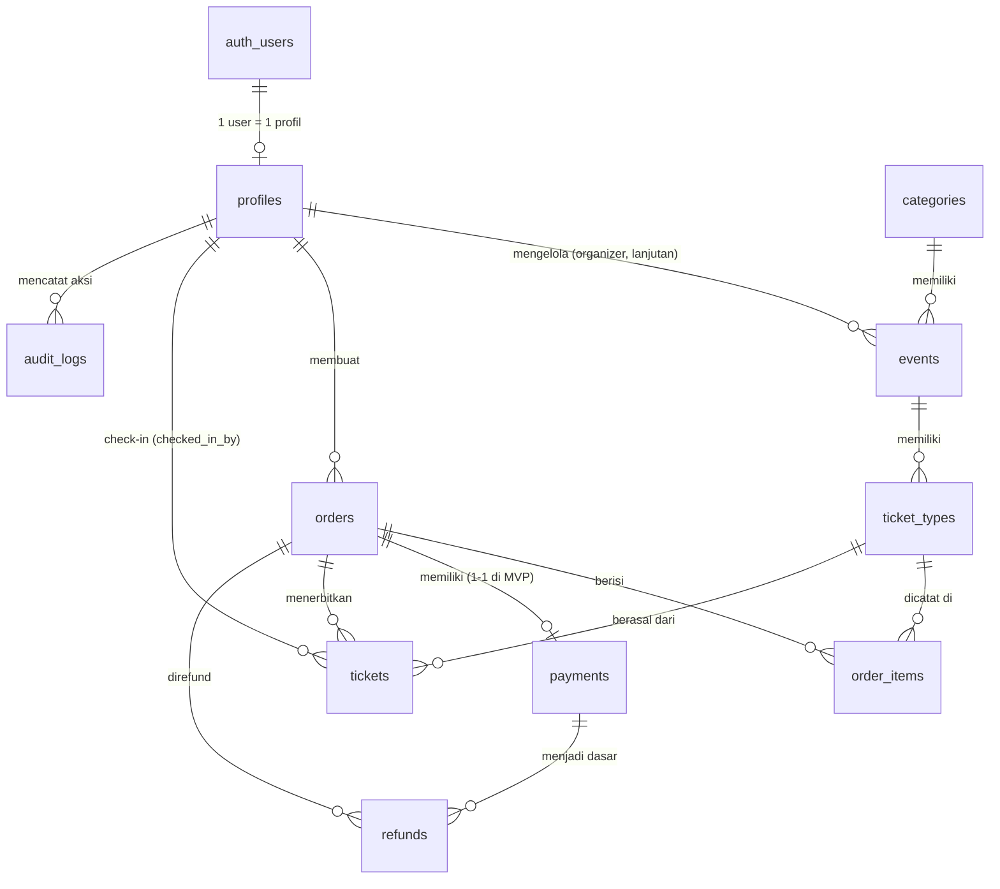

# Data Model — Struktur Database

> Dokumen ini menjelaskan **tabel-tabel di Supabase Postgres**, apa saja kolomnya,
> bagaimana tabel saling terhubung, dan beberapa aturan khusus supaya sistem aman
> (anti oversell, uang integer, status enum, dan Row Level Security / RLS).
> Sederhana, sesuai kebutuhan MVP.

---

## 1. Aturan Dasar (dibaca dulu)

1. **Uang disimpan sebagai INTEGER (dalam Rupiah, tanpa desimal).** Harga tidak pernah
   memakai `float`/`decimal`. Contoh: harga `150000` artinya **Rp 150.000**. Alasan: kalkulasi
   float bisa menghasilkan pembulatan salah (mis. `0.1 + 0.2`). Format `Rp 150.000` hanya dibuat
   saat ditampilkan di frontend.
2. **Status disimpan sebagai ENUM Postgres** (bukan string bebas / angka), supaya nilai yang
   masuk tidak bisa salah ketik. Enumerasi status ditulis di bagian 2.
3. **Stok tidak boleh oversell.** Dikunci dengan fungsi SQL atomik (bagian 6).
4. **Semua table punya kolom waktu** `created_at` (dan `updated_at` untuk data yang bisa diubah).
5. **ID memakai `uuid`** sebagai primary key (kecuali disebut lain).

---

## 2. Enumerasi (jenis nilai tetap)

| Nama enum | Nilai yang diizinkan | Dipakai di |
| --- | --- | --- |
| `user_role` | `user`, `staff`, `admin`, `organizer` | `profiles.role` |
| `event_status` | `draft`, `published`, `ended`, `cancelled` | `events.status` |
| `order_status` | `awaiting_payment`, `completed`, `expired`, `cancelled` | `orders.status` |
| `payment_status` | `pending`, `paid`, `failed`, `expired`, `refunded` | `payments.status` |
| `ticket_status` | `valid`, `used`, `cancelled` | `tickets.status` |

> Status-order dan status-pembayaran adalah dua hal berbeda (lihat `docs/order-flow.md`).
> Keduanya disimpan di tabel terpisah: `orders.status` dan `payments.status`.

---

## 3. Diagram ERD (hubungan antar tabel)



Catatan: `auth_users` adalah tabel bawaan Supabase Auth (tidak kita buat).
`profiles` menyambung ke situ lewat `id`.

---

## 4. Penjelasan Tiap Tabel

### 4.1 `profiles` — profil pengguna

Menghubungkan akun Supabase Auth ke data kita, dan menyimpan role.
**Tujuan:** tahu siapa user-nya dan role apa yang dia punya (RBAC).

| Kolom | Tipe | Wajib | Keterangan |
| --- | --- | --- | --- |
| `id` | uuid | ya | PK. Sama dengan `auth.users.id` |
| `full_name` | text | ya | Nama lengkap |
| `avatar_url` | text | tidak | URL foto profil |
| `role` | `user_role` | ya | Default `user`. Staff/admin diatur admin |
| `created_at` | timestamptz | ya | Default `now()` |
| `updated_at` | timestamptz | ya | Di-update otomatis |

**Relasi:** `id` → `auth.users.id` (1-1).
**Index penting:** `role`.

> Email tidak disimpan di sini; dibaca langsung dari `auth.users` (satu sumber kebenaran).
> Saat user baru mendaftar, **trigger Postgres** membuat 1 baris `profiles` otomatis. Kita
> tidak pernah mengubah `auth.users` dari kode aplikasi.

---

### 4.2 `categories` — kategori event

**Tujuan:** mengelompokkan event (mis. Konser, Seminar, Workshop) untuk filter.

| Kolom | Tipe | Wajib | Keterangan |
| --- | --- | --- | --- |
| `id` | uuid | ya | PK |
| `name` | text | ya | Nama kategori, mis. "Konser" |
| `slug` | text | ya | UNIQUE, mis. `konser` (dipakai di URL/filter) |
| `created_at` | timestamptz | ya | Default `now()` |

**Relasi:** (none) — dipakai `events.category_id`.
**Index penting:** UNIQUE `slug`.

---

### 4.3 `events` — event

**Tujuan:** menyimpan informasi event yang dijual tiketnya.

| Kolom | Tipe | Wajib | Keterangan |
| --- | --- | --- | --- |
| `id` | uuid | ya | PK |
| `organizer_id` | uuid | tidak | FK → `profiles.id`. Untuk role organizer (fase lanjutan); kosong di MVP |
| `category_id` | uuid | ya | FK → `categories.id` |
| `title` | text | ya | Judul event |
| `slug` | text | ya | UNIQUE, untuk URL (mis. `konser-nidji-2026`) |
| `description` | text | ya | Deskripsi event |
| `location` | text | ya | Tempat (mis. "JIExpo, Jakarta") |
| `image_url` | text | tidak | URL poster/cover |
| `starts_at` | timestamptz | ya | Waktu mulai (dipakai pembanding tanggal) |
| `ends_at` | timestamptz | ya | Waktu selesai |
| `status` | `event_status` | ya | Default `draft`; user publik hanya melihat `published` |
| `created_at` | timestamptz | ya | Default `now()` |
| `updated_at` | timestamptz | ya | Di-update otomatis |

**Relasi:** banyak-ke-satu `categories`, banyak-ke-banyak ke `ticket_types` (satu event banyak tipe).
**Index penting:** `(status, starts_at)` untuk list publik terurut tanggal; `category_id`; UNIQUE `slug`.

---

### 4.4 `ticket_types` — jenis tiket per event

**Tujuan:** menyimpan harga, stok, dan aturan beli per jenis tiket (mis. "VIP", "Reguler").

| Kolom | Tipe | Wajib | Keterangan |
| --- | --- | --- | --- |
| `id` | uuid | ya | PK |
| `event_id` | uuid | ya | FK → `events.id` |
| `name` | text | ya | Nama jenis tiket, mis. "VIP" |
| `price` | integer | ya | Harga per tiket **dalam Rupiah integer** (≥ 0) |
| `stock_total` | integer | ya | Kapasitas total jenis tiket ini (≥ 0) |
| `stock_sold` | integer | ya | Jumlah yang sudah dipesan (dikunci/dibayar). Default 0 |
| `max_per_order` | integer | ya | Batas maksimal beli per 1 order (mis. 5) |
| `is_active` | boolean | ya | Default `true`; `false` = tidak dijual lagi |
| `created_at` | timestamptz | ya | Default `now()` |
| `updated_at` | timestamptz | ya | Di-update otomatis |

**Cara hitung sisa stok:** `sisa = stock_total - stock_sold`. Kalau `stock_sold` dinaikkan
melewati `stock_total` → dilarang (lihat bagian 6).

**Relasi:** banyak-ke-satu `events`; satu-ke-banyak ke `order_items` dan `tickets`.
**Index penting:** `(event_id, is_active)`; UNIQUE tak ada (event boleh punya beberapa jenis tiket).

---

### 4.5 `orders` — pesanan

**Tujuan:** satu transaksi beli (bisa berisi beberapa jenis tiket).

| Kolom | Tipe | Wajib | Keterangan |
| --- | --- | --- | --- |
| `id` | uuid | ya | PK |
| `order_number` | text | ya | UNIQUE, nomor pesanan tampil ke user (mis. `ORD-2026-0001`) |
| `user_id` | uuid | ya | FK → `profiles.id`, pemilik pesanan |
| `status` | `order_status` | ya | Default `awaiting_payment` |
| `total_amount` | integer | ya | Total harga **Rupiah integer** |
| `payment_due_at` | timestamptz | ya | Batas waktu bayar (mis. created + 15 menit) |
| `invoice_number` | text | tidak | Nomor invoice. Terisi saat sudah `paid` |
| `created_at` | timestamptz | ya | Default `now()` |
| `updated_at` | timestamptz | ya | Di-update otomatis |

**Relasi:** banyak-ke-satu `profiles`; satu-ke-banyak ke `order_items`, `tickets`, `refunds`.
**Index penting:** `(user_id, created_at)` untuk riwayat pesanan user; `(status, payment_due_at)`
untuk menjalankan tugas expired otomatis (cron).

---

### 4.6 `order_items` — isi pesanan

**Tujuan:** mencatat apa saja yang dibeli dalam 1 order, **dengan harga saat itu juga**
(supaya kalau admin mengubah harga, order lama tidak terpengaruh).

| Kolom | Tipe | Wajib | Keterangan |
| --- | --- | --- | --- |
| `id` | uuid | ya | PK |
| `order_id` | uuid | ya | FK → `orders.id` |
| `ticket_type_id` | uuid | ya | FK → `ticket_types.id` |
| `quantity` | integer | ya | Jumlah tiket (≥ 1) |
| `unit_price` | integer | ya | Harga satuan **pada saat order dibuat** (snapshot) |
| `subtotal` | integer | ya | `quantity * unit_price` |

**Relasi:** banyak-ke-satu `orders` dan `ticket_types`.
**Index penting:** `order_id`; `ticket_type_id`.

---

### 4.7 `payments` — pembayaran

**Tujuan:** melacak status pembayaran 1 order. Di MVP: **1 order = 1 baris payment**
(diubah statusnya, tidak dibuat baris baru).

| Kolom | Tipe | Wajib | Keterangan |
| --- | --- | --- | --- |
| `id` | uuid | ya | PK |
| `order_id` | uuid | ya | FK → `orders.id`, UNIQUE (1 order = 1 payment) |
| `amount` | integer | ya | Jumlah yang harus dibayar **Rupiah integer** |
| `status` | `payment_status` | ya | Default `pending` |
| `method` | text | ya | `simulation` (MVP). Nanti `midtrans` / `xendit` |
| `provider_tx_id` | text | tidak | ID transaksi dari payment gateway (isi saat integrasi asli) |
| `paid_at` | timestamptz | tidak | Terisi saat status jadi `paid` |
| `created_at` | timestamptz | ya | Default `now()` |
| `updated_at` | timestamptz | ya | Di-update otomatis |

**Relasi:** satu-ke-satu `orders`; satu-ke-banyak `refunds`.
**Index penting:** UNIQUE `order_id`; `(status, created_at)`.

---

### 4.8 `tickets` — tiket digital (e-ticket)

**Tujuan:** satu baris = satu tiket. Saat order `paid`, sistem menerbitkan 1 baris per tiket.
**Beli 3 tiket → 3 baris tiket → 3 QR Code berbeda.**

| Kolom | Tipe | Wajib | Keterangan |
| --- | --- | --- | --- |
| `id` | uuid | ya | PK |
| `order_id` | uuid | ya | FK → `orders.id` |
| `ticket_type_id` | uuid | ya | FK → `ticket_types.id` |
| `code` | text | ya | UNIQUE, nomor tiket yang mudah dibaca (mis. `TKT-VIP-000123`) |
| `qr_token` | text | ya | UNIQUE, string acak panjang yang dikodekan di QR (mis. 32 karakter acak) |
| `status` | `ticket_status` | ya | Default `valid` |
| `used_at` | timestamptz | tidak | Terisi saat check-in berhasil |
| `checked_in_by` | uuid | tidak | FK → `profiles.id`, staff/admin yang memindai |
| `created_at` | timestamptz | ya | Default `now()` |

**Relasi:** banyak-ke-satu `orders`, `ticket_types`; banyak-ke-satu `profiles` (untuk
`checked_in_by`).
**Index penting:** UNIQUE `qr_token`; UNIQUE `code`; `order_id`; `status`.

> `qr_token` dihasilkan dengan kriptografi acak yang kuat. `code` dibuat agar enak dibaca
> manusia. Check-in memakai `qr_token` (hasil pindai QR).

---

### 4.9 `refunds` — catatan refund

**Tujuan:** mencatat setiap refund yang terjadi (siapa, untuk apa, berapa).

| Kolom | Tipe | Wajib | Keterangan |
| --- | --- | --- | --- |
| `id` | uuid | ya | PK |
| `order_id` | uuid | ya | FK → `orders.id` |
| `payment_id` | uuid | ya | FK → `payments.id` |
| `amount` | integer | ya | Uang yang dikembalikan **Rupiah integer** |
| `reason` | text | tidak | Alasan refund |
| `refunded_by` | uuid | ya | FK → `profiles.id`, admin yang memproses |
| `created_at` | timestamptz | ya | Default `now()` |

**Relasi:** banyak-ke-satu `orders` dan `payments`.
**Index penting:** `order_id`; `payment_id`.

> Saat refund berhasil: `payments.status = refunded`, tiket terkait jadi `cancelled`,
> dan `stock_sold` dikurangi (slot bisa dijual lagi). Sesuai `docs/order-flow.md`.

---

### 4.10 `audit_logs` — catatan riwayat aksi

**Tujuan:** mencatat "siapa melakukan apa, kapan" untuk keamanan & investigasi.

| Kolom | Tipe | Wajib | Keterangan |
| --- | --- | --- | --- |
| `id` | uuid | ya | PK |
| `actor_id` | uuid | tidak | FK → `profiles.id`; `NULL` kalau aksi dari sistem/cron |
| `action` | text | ya | Nama aksi (mis. `order.created`, `payment.refunded`, `check_in`) |
| `entity_type` | text | ya | Jenis data (mis. `orders`, `tickets`) |
| `entity_id` | uuid | ya | ID data yang diakses |
| `details` | jsonb | tidak | Info tambahan (mis. sebelum/sesudah status) |
| `created_at` | timestamptz | ya | Default `now()` |

**Relasi:** banyak-ke-satu `profiles` (actor, opsional).
**Index penting:** `created_at`; `actor_id`; `(entity_type, entity_id)`.

> Baris di tabel ini **tidak pernah diubah atau dihapus** (append-only).

---

## 5. Kebijakan RLS (Row Level Security) — garis besar

RLS = pengaman di level Postgres: **per baris**. Tanpa kebijakan yang cocok, sebuah role
tidak bisa membaca baris sama sekali. Ini pengaman kedua setelah pengecekan di kode.

Cara umum di MVP (check policy):

| Tabel | Membaca (select) | Menulis (insert/update/delete) |
| --- | --- | --- |
| `profiles` | User: baris sendiri. Admin: semua | User: update baris sendiri (bukan role). Admin: semua |
| `categories` | Publik | Admin saja |
| `events` | Publik: hanya `status = 'published'`. Admin: semua | Admin saja (service role untuk tugas sistem) |
| `ticket_types` | Publik | Admin saja |
| `orders` | Pemilik (`user_id = auth.uid()`). Admin: semua | Insert oleh pemilik. Update hanya lewat service role / RPC (agar transaksi atomik tetap aman) |
| `order_items` | Pemilik order. Admin | Insert oleh pemilik; update/delete lewat sistem |
| `payments` | Pemilik order. Admin | Ditulis lewat service role / RPC |
| `tickets` | Pemilik order. Staff: untuk validasi. Admin | Ditulis lewat service role (terbit e-ticket, check-in) |
| `refunds` | Admin; user (via order milik sendiri) | Service role / admin |
| `audit_logs` | Admin | Insert via service role saja |

Catatan penting:

- **RLS bukan pengganti pengecekan role di kode.** Pengecekan di Route Handler tetap wajib
  (lihat `docs/permission.md`). RLS mencegah kesalahan fatal kalau kode lupa.
- Operasi yang butuh beberapa ubah dalam **satu transaksi atomik** (buat order, kurangi stok,
  terbitkan tiket) dilakukan lewat **RPC (fungsi SQL)** dengan `service role` — ini legal karena
  berjalan di server dengan key khusus, **sama sekali tidak pernah dipakai di browser**.
- Akses service role **membypass RLS**. Karena itu key-nya tidak boleh bocor ke frontend
  (lihat `docs/architecture.md`).

---

## 6. Mencegah Oversell — fungsi SQL atomik

**Masalah:** dua user memesan tiket terakhir bersamaan. Kalau kita "baca stok, lalu kurangi"
secara terpisah, dua-duanya bisa berhasil → terjual 2 dari sisa 1.

**Solusi:** lakukan pengecekan + pengurangan + pembuatan order dalam **satu transaksi**,
dan tambahkan syarat di baris `UPDATE` itu sendiri. Kalau syarat gagal, berarti tiket sudah
habis → tolak.

Ilustrasi bentuknya (dijalankan lewat RPC Supabase, `reserve_tickets`):

```sql
-- Satu transaksi: cek antri, kurangi 1, buat order (contoh skema sederhana)
BEGIN;

  -- Kunci & kurangi stok SEKALIGUS, hanya kalau masih cukup.
  UPDATE ticket_types
  SET stock_sold = stock_sold + pesanan_jumlah
  WHERE id = tipe_tiket_id
    AND is_active = true
    AND stock_sold + pesanan_jumlah <= stock_total;

  -- Kalau tidak ada SATU pun baris yang terpengaruh => stok habis.
  -- (Postgres menjalankan update baris yang punya lock; di sini 0 baris = gagal)
  IF NOT FOUND THEN
    RAISE EXCEPTION 'OUT_OF_STOCK';
  END IF;

  -- Sekarang stok aman, buat order + item dalam transaksi yang sama.
  INSERT INTO orders (...) VALUES (...);
  INSERT INTO order_items (...) VALUES (...);

COMMIT;  -- Semua berhasil bersama, atau rollback semua bersama.
```

Kenapa cara ini aman:

- `UPDATE ... WHERE stock_sold + pesanan_jumlah <= stock_total` **mengunci baris** `ticket_types`
  saat dieksekusi; user kedua akan menunggu sampai transaksi pertama selesai, lalu mendapat 0 baris.
- `BEGIN`/`COMMIT` menjadikan "kurangi stok" dan "buat order" **atomik** (all-or-nothing). Kalau
  proses di tengah gagal, stok ikut dikembalikan otomatis.

Pengembalian stok (saat `expired`, `failed`, `cancelled`, `refunded`) memakai pola kebalikan:
`UPDATE ticket_types SET stock_sold = stock_sold - jumlah WHERE id = ...`, tetap dalam 1 transaksi
dengan perubahan status order/tiket. Rincian alurnya ada di `docs/order-flow.md`.

---

## 7. Ringkasan Hubungan Penting

- **1 user → banyak order → banyak ticket.** Order bisa berisi beberapa jenis tiket via `order_items`.
- **1 event → banyak ticket_types.** Stok dijaga di `ticket_types` (`stock_total - stock_sold`).
- **1 order → 1 payment** (MVP). Payment punya status sendiri; 2 `status` terpisah untuk order & pembayaran.
- **1 order → banyak refunds.** Refund menurunkan `stock_sold` dan mematikan tiket (`cancelled`).
- **Semua angka uang integer Rupiah**, **semua status enum**.

---

## 8. Dokumen Terkait

- `docs/order-flow.md` — alur status order/pembayaran dan logika stok (sumber status).
- `docs/permission.md` — siapa boleh mengakses tabel mana (dasar RLS + cek role).
- `docs/architecture.md` — cara aplikasi memakai tabel ini (pola 3 lapis, RPC, dua client Supabase).
- `docs/api-contract.md` — data apa saja yang keluar dari API (berpadan dengan tabel di atas).