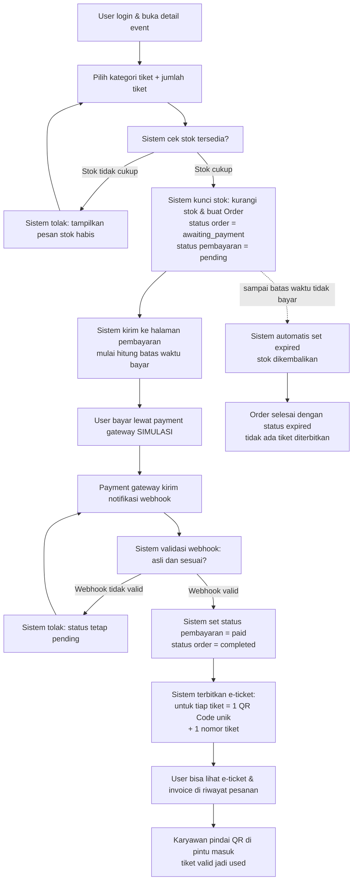
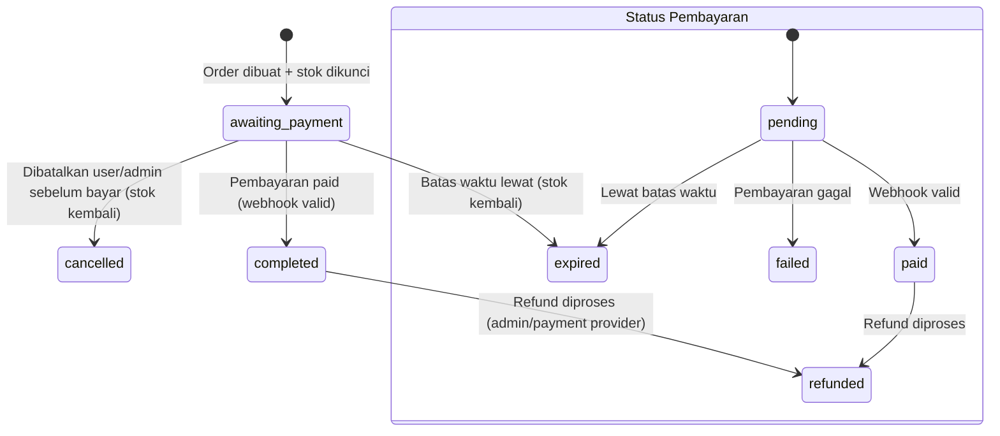
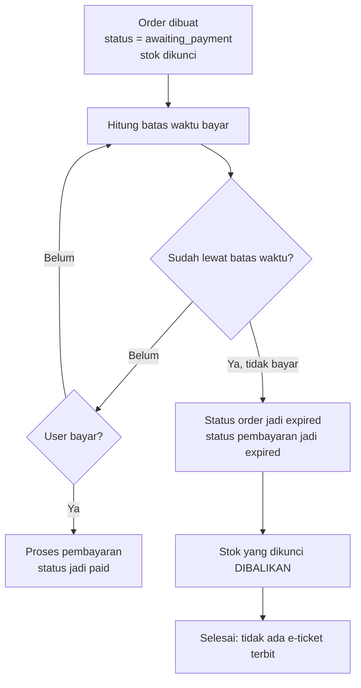

# Order Flow — Alur Pesanan Tiket

> Dokumen ini menjelaskan **seluruh alur** dari user memilih tiket sampai e-ticket terbit,
> termasuk status order, status pembayaran, dan bagaimana stok dijaga supaya tidak oversell.

---

## 1. Istilah Penting dulu

| Istilah | Arti |
| --- | --- |
| **Order** | Satu keranjang/transaksi beli tiket. Berisi 1 atau lebih tiket. |
| **Order Item** | Satu baris tiket dalam order (mis. 2 tiket VIP = 2 order item). |
| **Tiket (digital)** | Unit yang benar-benar dikeluarkan: 1 tiket = 1 QR Code unik. |
| **Status Order** | Kondisi pesanan secara keseluruhan (mis. `awaiting_payment`, `completed`). |
| **Status Pembayaran** | Kondisi pembayaran (mis. `pending`, `paid`, `failed`, `expired`, `refunded`). |
| **Stok** | Jumlah tiket yang masih bisa dijual untuk satu kategori tiket. |
| **Batas waktu bayar** | Tenggat pembayaran (mis. 15 atau 30 menit). Lewat dari itu order automatis `expired`. |

---

## 2. Alur Utama (dari pilih tiket sampai e-ticket terbit)



### Penjelasan per langkah (versi bacaan)

1. **Pilih tiket.** User pilih kategori tiket (mis. VIP) dan jumlah (mis. 2).
2. **Cek stok.** Server mengecek stok kategori itu saat itu juga.
3. **Kunci stok.** Kalau cukup, stok langsung dikurangi dan **order dibuat dalam satu transaksi
   database**. Inilah "kunci stok" supaya tidak ada oversell.
4. **Pembayaran.** Order dibuat dengan status pembayaran `pending` dan batas waktu. Setelah
   bayar (di MVP: simulasi), penyedia/pengganti mengirim notifikasi.
5. **Validasi webhook.** Notifikasi dicek dulu: signature & datanya cocok dengan order? Kalau
   tidak cocok, diabaikan (tidak dianggap bayar).
6. **Terbitkan e-ticket.** Saat pembayaran `paid`, sistem membuat tiket digital: **setiap tiket
   punya 1 nomor tiket dan 1 QR Code unik.** Beli 3 tiket → 3 QR berbeda.
7. **Check-in.** Staff memindai QR; tiket `valid` berubah jadi `used`. Yang sudah `used` tidak
   bisa dipakai lagi.

---

## 3. Status Order dan Status Pembayaran

Kita pisahkan dua hal ini, karena pembayaran bisa dibatalkan tanpa menghapus riwayat order.
Order menyimpannya sendiri.

### 3.1 Status Order

| Status Order | Arti |
| --- | --- |
| `awaiting_payment` | Order dibuat, belum dibayar, masih dalam batas waktu. |
| `completed` | Pembayaran sukses, e-ticket terbit. |
| `expired` | Batas waktu lewat tanpa bayar (stok sudah kembali). |
| `cancelled` | Dibatalkan (oleh user sebelum bayar, atau oleh admin). |

> `refunded` dipakai di level **status pembayaran** (bukan status order), karena order tetap
> ada tapi uangnya dikembalikan.

### 3.2 Status Pembayaran

| Status Pembayaran | Arti |
| --- | --- |
| `pending` | Menunggu bayar (dalam batas waktu). |
| `paid` | Uang masuk / tayar sukses. |
| `failed` | Pembayaran gagal diproses. |
| `expired` | Batas waktu lewat, pembayaran tidak terjadi. |
| `refunded` | Uang sudah dikembalikan ke user. |

### 3.3 Diagram transisi yang diperbolehkan

> Panah = perubahan yang **boleh** terjadi. Semua perubahan status hanya boleh dari server,
> dan dicatat ke audit log.



Aturan penting dalam diagram ini:

- Dari `pending` **tidak boleh langsung** ke `refunded` (belum bayar, tidak ada yang di-refund).
- Dari `paid` **tidak boleh** kembali ke `pending`.
- `expired` dan `cancelled` adalah status akhir untuk order yang belum `completed`.
- `refunded` hanya boleh dicapai dari **`paid`** (atau langsung dari pemrosesan gateway saat
  memproses refund), tidak pernah dari `pending`.

---

## 4. Alur Expired (tidak bayar sampai batas waktu)



Cara kerja automatis expired (panduan):

1. Saat order dibuat, simpan kolom `payment_due_at` = waktu sekarang + batas waktu bayar
   (misal 15 menit).
2. Ada dua mekanisme: (a) **cek saat diakses** (lazy) — tiap kali order dibuka/dibayar, sistem
   memeriksa apakah sudah lewat `payment_due_at` lalu menandai `expired` + mengembalikan stok;
   (b) **Vercel Cron harian** — endpoint `GET /api/cron/expire-orders` (dilindungi `CRON_SECRET`)
   mencari order `pending` yang sudah lewat `payment_due_at` dan mengeksekusi hal yang sama.
3. Order yang kedaluwarsa diubah jadi `expired`, lalu **stok dikembalikan** (lihat bagian 5).
4. Kalau yang terjadi adalah pembayaran **gagal** (`failed`), stok juga harus dikembalikan,
   karena tiketnya tidak jadi dibeli.

> Lihat detail arsitektur: `docs/architecture.md` (bagian "Strategi Expired Order").

---

## 5. Mengunci dan Mengembalikan Stok (Anti Oversell)

### 5.1 Mengapa stok harus "dikunci"?

Kalau sistem hanya mengecek stok sekali lalu tidak mengurangi, dua user bisa membeli tiket
terakhir yang sama hampir bersamaan → **oversell** (terjual melebihi kapasitas). Kunci stok
dilakukan supaya jumlah yang terjual tidak pernah melebihi kapasitas.

### 5.2 Kapan stok dikurangi (dikunci)?

- **Saat order dibuat** (masih `awaiting_payment`), stok kategori tiket langsung dikurangi
  sebesar jumlah tiket yang dibeli, **dalam satu transaksi database** yang sama dengan pembuatan
  order. Inilah yang mengunci kapasitas.

Situasi yang wajib dicek di server:

- Stok kategori tiket **tidak boleh negatif**. Kalau user minta 5 tapi sisa 3 → ditolak.
- Perubahan stok dan pembuatan order terjadi **dalam satu transaksi atomik** (semua berhasil
  bersama, atau semua gagal bersama). Jangan kurangi stok dulu lalu buat order setelahnya
  tanpa transaksi, karena bisa bolong di tengah jalan.

### 5.3 Kapan stok dikembalikan?

| Kondisi | Aksi stok |
| --- | --- |
| Order `expired` (lewat batas waktu tanpa bayar) | Stok **dikembalikan** |
| Pembayaran `failed` | Stok **dikembalikan** |
| Order `cancelled` (dibatalkan sebelum bayar) | Stok **dikembalikan** |
| Pembayaran `paid` → e-ticket terbit | Stok **tetap berkurang** (tidak dikembalikan) |
| `refunded` | Stok **dikembalikan** (slot tiket bisa dijual lagi), dan uang dikembalikan ke user |

Aturan ringkasnya: **stok dikurangi saat order dibuat, dan dikembalikan saat order gagal /
dibatalkan / expired / direfund.** Yang perlu diingat: e-ticket yang lama tetap dimatikan
(`cancelled`) supaya QR-nya tidak bisa dipakai lagi—slot yang kosong diisi oleh pembeli baru.

---

## 6. Alur Refund

```mermaid
flowchart TD
    A[Pembayaran paid<br/>e-ticket sudah terbit] --> B[User ajukan refund<br/>atau admin pilih refund]
    B --> C{Cek syarat refund?}
    C -- Belum lewat deadline event & tiket belum dipakai --> D[Proses refund (simulasi di MVP)]
    D --> E[Status pembayaran jadi refunded]
    E --> F[Status tiket jadi cancelled<br/>QR tidak bisa dipakai lagi]
    F --> F2[Stok dikembalikan<br/>slot tiket bisa dijual lagi]
    C -- Tidak memenuhi syarat --> G[Refund ditolak<br/>status tetap paid]

    B2[Pembayaran masih pending] --> H[User/ admin batalkan order]
    H --> I[Status order cancelled<br/>status pembayaran expired/dibatalkan<br/>stok kembali]
```

Penjelasan:

- **Refund** hanya masuk akal untuk order yang sudah `paid`. Sebelum `paid`, bukan refund
  namanya, itu pembatalan order.
- Saat refund jadi `refunded`, tiketnya dimatikan (`cancelled`) supaya QR-nya tidak bisa
  dipakai di pintu masuk, dan **stok dikembalikan** (slot tiket bisa dijual lagi).
- Di **MVP**, refund bisa berupa aksi admin (simulasi). Integrasi pembayaran sungguhan
  dengan Midtrans/Xendit adalah **fase lanjutan**.
- Setiap refund dicatat di audit log: siapa, untuk order apa, kapan, alasan.

---

## 7. Ringkasan 1 Paragraf

Order dibuat saat user pilih tiket, pada saat itu juga **stok langsung dikunci** (dikurangi
dalam 1 transaksi) supaya tidak oversell. Order berstatus pembayaran `pending` dan punya batas
waktu. Kalau bayar sukses (webhook valid), status jadi `paid`/`completed` dan sistem menerbitkan
e-ticket—**1 QR unik per tiket**. Kalau lewat batas waktu, status jadi `expired` dan **stok
dikembalikan**. Kalau refund setelah `paid`, uang dikembalikan, **stok dikembalikan**, dan QR dimatikan.

---

## 8. Dokumen Terkait

- `docs/PRD.md` — fitur & prioritas (MVP / Lanjutan).
- `docs/permission.md` — siapa boleh membuat/mengubah status order (role dan aturan kepemilikan).
- `docs/data-model.md` — tabel yang menyimpan order, tiket, status, dan stok (dibuat saat coding).